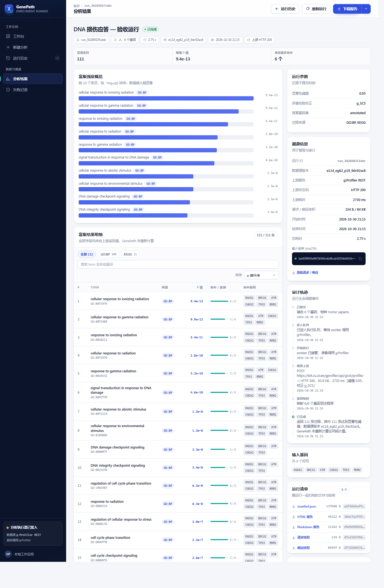
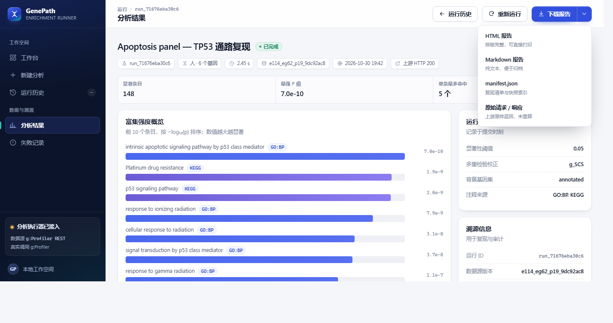
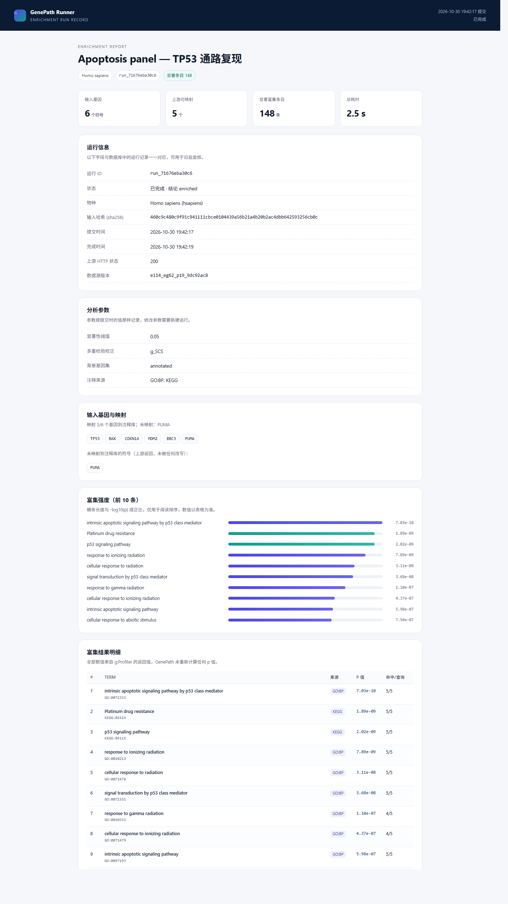
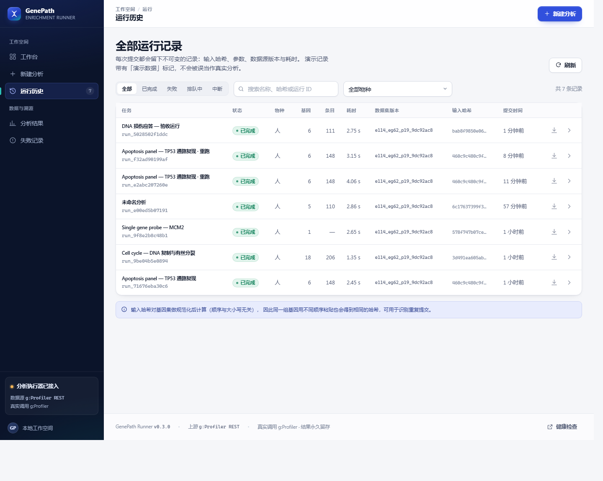
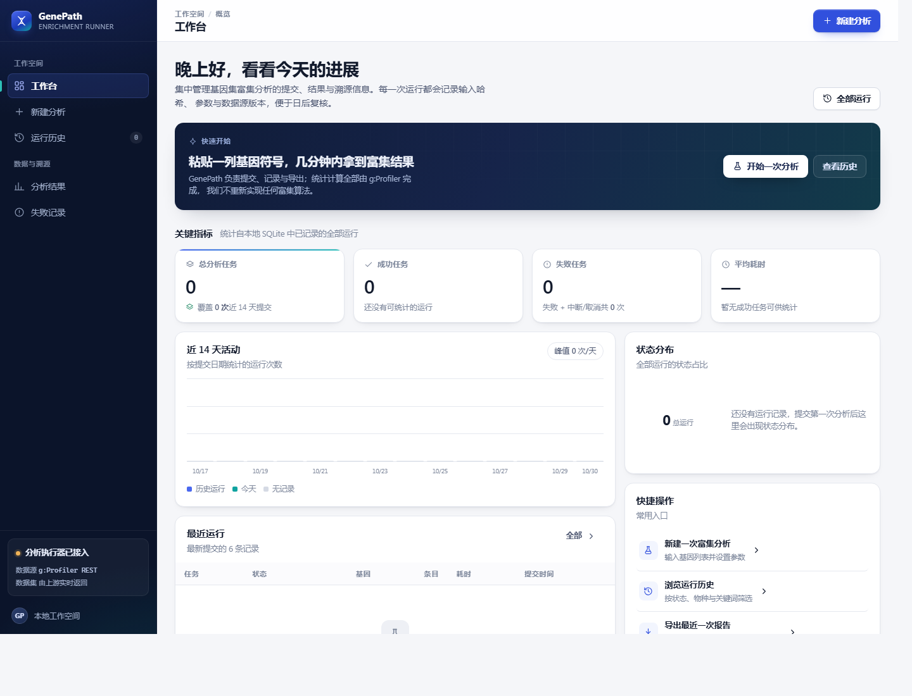
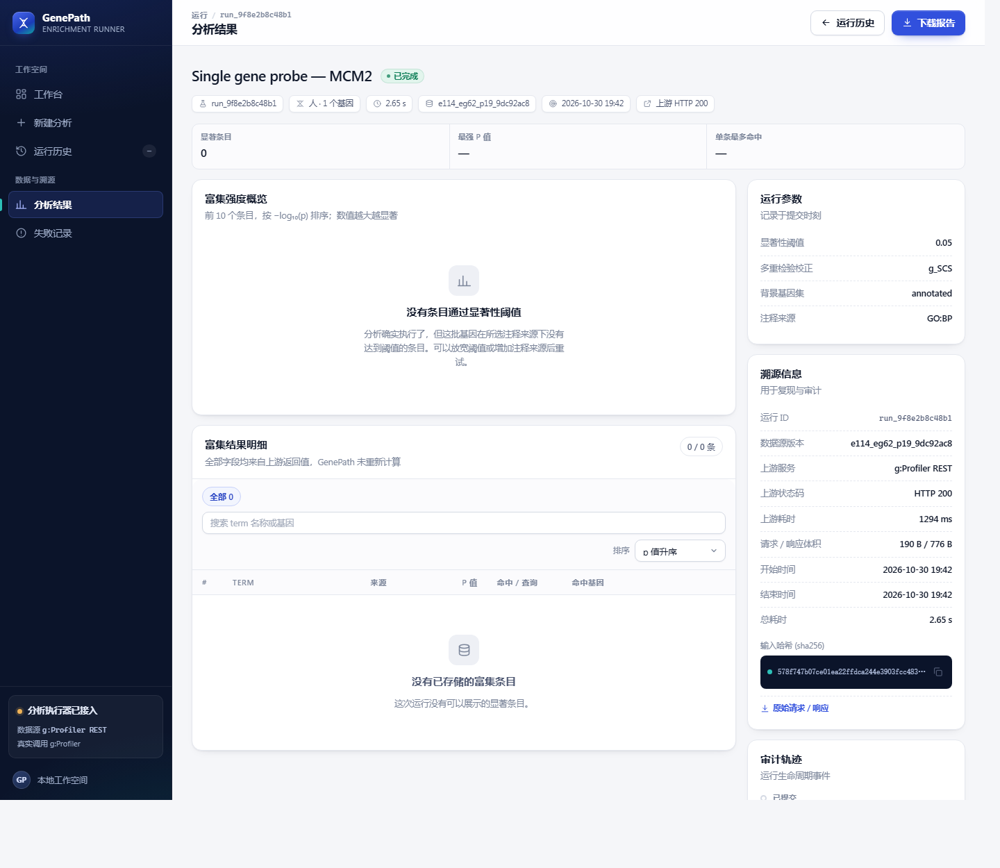

# GenePath Runner

**给基因富集分析做"可复现运行记录"的 Web 工具。** 粘贴一组基因，GenePath 负责提交、排队、调用 [g:Profiler](https://biit.cs.ut.ee/gprofiler/)、保存结果与溯源、导出报告。


它**不重新实现富集算法**，也不生成生物学结论。富集统计全部来自 g:Profiler，项目关心的是另一些工程问题：输入怎么校验、任务怎么排队、上游超时怎么记录、几个月后怎么证明这次结果是真的。

## 功能

- **输入解析**：换行 / 逗号 / 分号 / 空格混排，自动去重、大小写不敏感、非法符号定位、上限 2000。
- **异步执行**：有界队列 + worker 池，提交立即返回，前端轮询状态，超时与重试有明确策略。
- **上游接入**：按官方文档构造请求，保存 `meta.version`、原始请求与原始响应，统计值原样落库。
- **三种真实结局**：`enriched` / `no_significant_terms` / `no_genes_mapped` 分开呈现，不把失败伪装成"没结果"。
- **溯源**：输入哈希、参数快照、数据源版本、HTTP 状态、耗时、字节数、事件时间线，一页看全。
- **运行清单**：每次成功运行自动归档 5 个文件——`report.html`、`report.md`、`manifest.json`、`request.json`、`response.json`——并把各自 SHA-256 写进 `artifacts` 表。
- **报告导出**：自包含的 HTML 报告（无外链、可离线打开、可直接打印）、Markdown 报告、`manifest.json` 复现清单。
- **历史回看与重新执行**：历史结果永远来自存档；「重新运行」会发起一次新的上游请求并**新建**一条记录，不动旧数据。
- **界面**：原生 HTML/CSS/JS，无框架无 CDN，静态资源 `go:embed` 进二进制，加载/空/错误三态都有专门设计。

## 快速开始

需要 Go 1.26+，以及能访问 `biit.cs.ut.ee` 的网络。

**Windows（cmd / PowerShell）**

```bat
git clone https://github.com/ytxz999/GenePath-Runner.git
cd GenePath-Runner
go build -o bin\genepath.exe .\cmd\server
bin\genepath.exe
```

**macOS / Linux**

```bash
git clone https://github.com/ytxz999/GenePath-Runner.git
cd GenePath-Runner
go build -o bin/genepath ./cmd/server
./bin/genepath
```

打开 <http://127.0.0.1:8080>，进「新建分析」，粘贴 `TP53, BAX, CDKN1A, MDM2, BBC3`，提交后 1–3 秒出结果。

> 命令行参数：`-addr :8080`、`-db data/genepath.db`、`-artifacts artifacts`、`-seed`（写入带「演示」标记的数据，默认关闭）、`-dev`。

## 可复现性

这部分是这个项目的重点，值得单独说明。

| 要证明的事 | 存放在哪里 |
| --- | --- |
| 输入到底是什么 | `runs.genes`（规范化后的符号）+ `runs.input_hash` |
| 用了哪些参数 | `runs.params`（显著性阈值、校正方法、背景集、注释来源） |
| 上游返回了什么 | `runs.raw_request` / `runs.raw_response`，以及归档的 `request.json` / `response.json` |
| 用的是哪版数据 | `runs.data_version`（g:Profiler 的 `meta.version`）、`runs.http_status`、耗时与字节数 |
| 文件有没有被改过 | `artifacts` 表里的 `sha256` 与 `size_bytes` |

输入哈希只覆盖**规范化后的基因集合与物种**，不含时间戳、不含运行 ID：

- 顺序无关（先排序）、大小写不敏感（统一大写后哈希）、去重后计算；
- 因此同一组基因无论换行序、大小写、粘贴时间，都会得到同一个哈希——这正是「识别重复提交」的依据；
- 旧版本数据库里的哈希会在启动时按当前规范化自动重建一次，日志里会打印重建条数。

两条必须说清的限制：

1. **历史回看 ≠ 重新执行。** 详情页展示的条目、p 值、命中基因都来自当次响应，GenePath 没有重算。点「重新运行」才会发起新的上游请求并生成新记录。
2. **数据源更新后不保证相同结果。** g:Profiler 的注释库与背景集会随版本变化，`manifest.json` 记录当时的 `data_version`，用来解释差异，而不是承诺"永远一样"。

## 截图

| 分析结果（真实数据） | 导出菜单 |
| --- | --- |
|  |  |

| HTML 报告（自包含） | 运行历史 |
| --- | --- |
|  |  |

| 空工作台（真实零值） | 没有显著条目 |
| --- | --- |
|  |  |

窄屏：`docs/screens/p2-dashboard-mobile.png`、`docs/screens/p2-results-mobile.png`。

## 架构

```text
handler (Gin) ──► service ──► repository ──► SQLite (GORM)
                     ▲                          │
                executor (worker 池)            └─► artifacts/（报告与快照文件）
                     │
                     └──► provider (g:Profiler REST)
```

`service` 不 import Gin，可脱离 HTTP 测试；`provider.Client` 是接口，测试用 `httptest` 伪造，因此测试不需要网络。提交走队列，真正调用上游的是 worker；报告与清单由 service 在运行成功后归档。

```text
cmd/server/          进程入口、参数、优雅退出、启动自检
internal/gene/       基因解析、去重、规范化哈希
internal/model/      Run / Term / Artifact / RunEvent
internal/service/    校验、状态机、结果转换、报告、manifest、重跑
internal/executor/   队列与 worker
internal/provider/   g:Profiler 客户端
internal/httpapi/    路由、handler、错误体
web/static/          四个页面与设计系统（无框架）
artifacts/<run_id>/  运行产物（默认被 gitignore）
```

细节见 [docs/DESIGN.md](docs/DESIGN.md)。

## API

| 方法 | 路径 | 说明 |
| --- | --- | --- |
| POST | `/api/v1/runs` | 提交分析，返回 `201` 与运行详情 |
| GET | `/api/v1/runs/:id` | 状态、参数、条目、事件、未映射基因 |
| GET | `/api/v1/runs/:id/results` | 富集条目 + 数据源版本与阈值 |
| GET | `/api/v1/runs/:id/raw` | 原始请求与响应 |
| GET | `/api/v1/runs/:id/report.html` | 自包含 HTML 报告（inline，严格 CSP） |
| GET | `/api/v1/runs/:id/report.md` | Markdown 报告 |
| GET | `/api/v1/runs/:id/manifest.json` | 复现清单（下载） |
| GET | `/api/v1/runs/:id/artifacts` | 归档文件列表：类型、大小、SHA-256、链接 |
| GET | `/api/v1/runs/:id/artifacts/:kind` | 下载单个归档文件 |
| POST | `/api/v1/runs/:id/rerun` | 用同一组输入与参数新建一次运行 |
| GET | `/api/v1/dashboard` | 工作台统计（全部来自数据库） |
| GET | `/healthz` · `/readyz` | 存活与就绪检查 |

错误统一为 `{ code, message, details }`，完整字段、错误码与示例见 [docs/API.md](docs/API.md)。

## 测试

```bash
go test ./... -count=1
go vet ./...
```

61 个测试函数，语句覆盖率：`gene` 98.0%、`executor` 91.4%、`httpapi` 78.3%、`provider` 74.1%、`service` 64.6%、`repository` 21.1%（只测了持久化与维护路径）。上游用 `httptest` 伪造，测试不联网。

重点用例：

- `TestArtifactBytesRegeneratesADeletedFile`：磁盘文件被删后仍能恢复，且数据库里的哈希与文件字节一致；
- `TestReportHTMLIsSelfContainedAndEscapesInput`：报告不引用外部资源，用户输入必须被转义；
- `TestManifestDescribesInputsAndSnapshots`：manifest 的基因、参数、数据源版本、映射与快照齐全；
- `TestInputHashIgnoresOrderCaseAndSubmissionTime`、`TestHashKeepsTheLegacyValueForUpperCaseSymbols`：哈希稳定且不吞掉历史值；
- `TestRecordsSurviveAReopen`：关库再开，运行、条目、事件、归档记录都还在。

## 诚实性约定

- 不重算 p 值、不改上游统计、不在页面上下生物学结论。
- 演示数据默认关闭；开启时永远带「演示」标记并落库。
- 上游失败就显示失败，未映射的基因显式列出，不悄悄丢弃。
- 排队中的任务只显示等待说明，不给一张假的成绩单。
- 空工作台显示真实的 0，不编造趋势；没有成功任务时不显示"平均耗时"。

## 路线图

- [x] 运行记录、可复现清单、HTML / Markdown 报告
- [x] 重新运行（新建记录，不覆盖历史）
- [ ] 取消接口（状态机里已有 `canceled`）
- [ ] `Dockerfile` 与 GitHub Actions
- [ ] CSV / PDF 报告导出
- [ ] 鉴权与多用户隔离

## 文档

| 文件 | 内容 |
| --- | --- |
| [docs/API.md](docs/API.md) | 端点、请求字段、错误码、响应示例 |
| [docs/DESIGN.md](docs/DESIGN.md) | 分层、数据模型、状态机、上游接入、报告与归档、测试与已知限制 |
| [docs/screens/](docs/screens/) | 验收截图 |

---

富集统计归 g:Profiler，本仓库只负责让每一次分析都可复现、可追溯、可导出。
