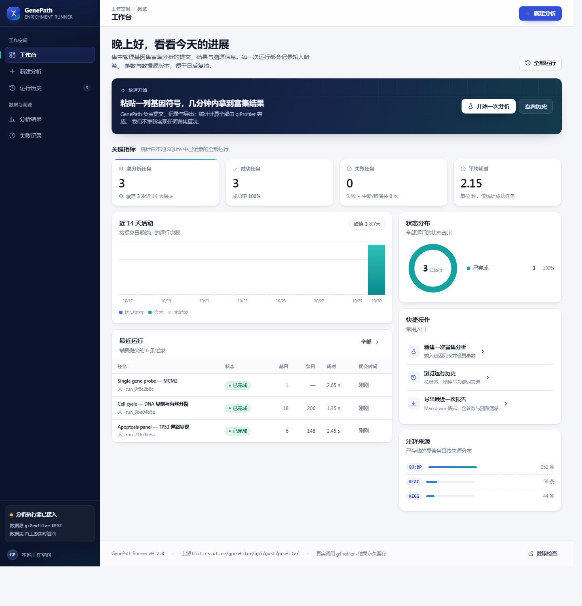
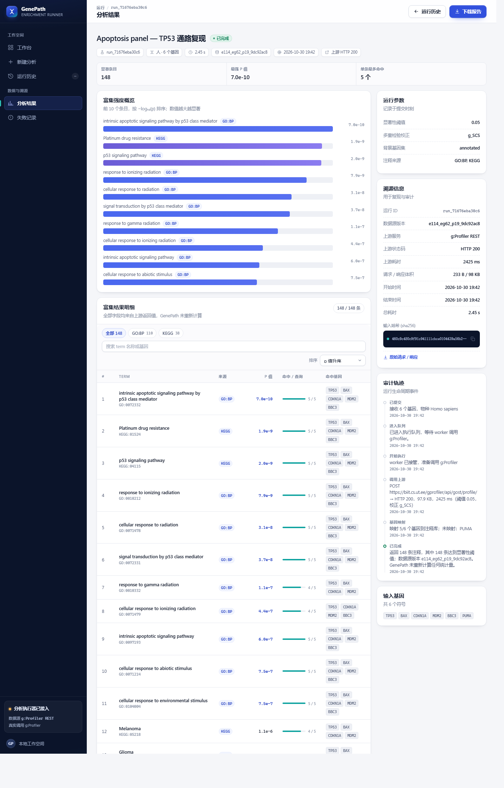
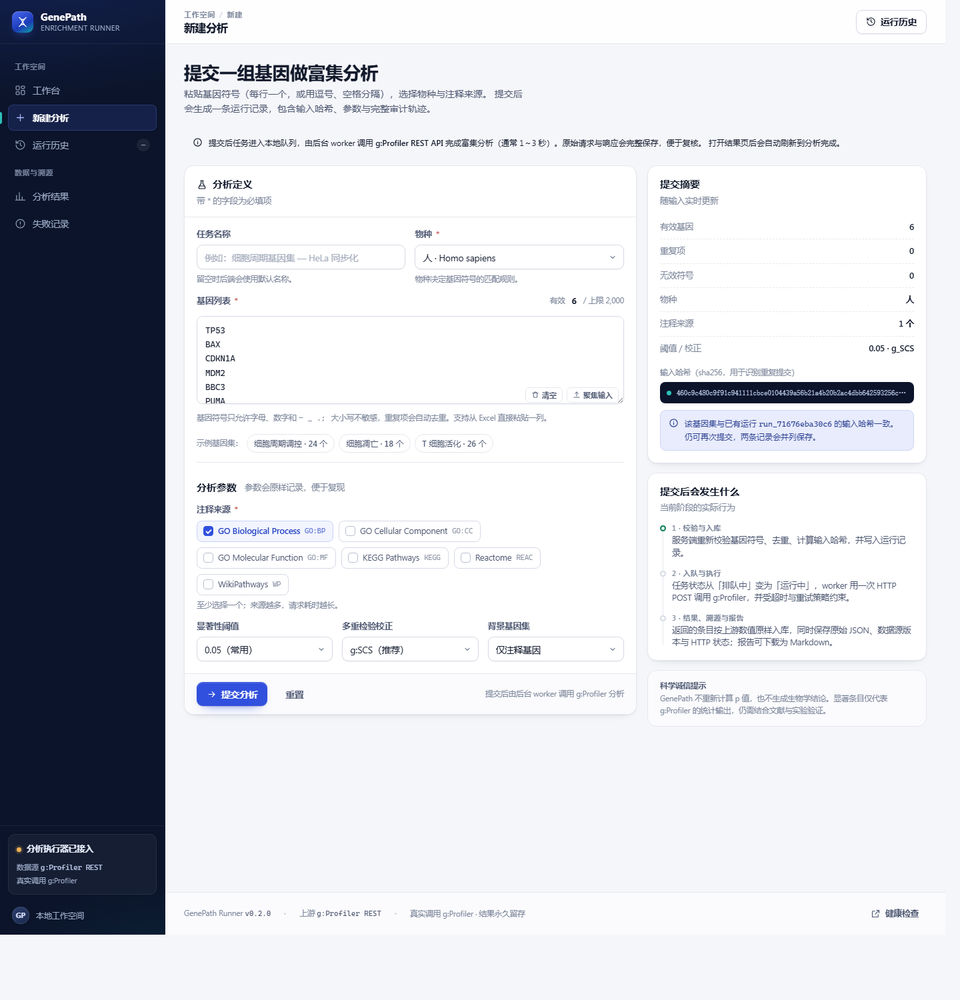

# GenePath Runner

**给基因富集分析做"可复现运行记录"的 Web 工具。** 粘贴一组基因，GenePath 负责提交、排队、调用 [g:Profiler](https://biit.cs.ut.ee/gprofiler/)、保存结果与溯源、导出报告。




它**不重新实现富集算法**，也不生成生物学结论。富集统计全部来自 g:Profiler，项目关心的是另一些工程问题：输入怎么校验、任务怎么排队、上游超时怎么记录、几个月后怎么证明这次结果是真的。

## 功能

- **输入解析**：换行 / 逗号 / 分号 / 空格混排，自动去重、大小写不敏感、非法符号定位、上限 2000。
- **异步执行**：有界队列 + worker 池，提交立即返回，前端轮询状态，超时与重试有明确策略。
- **上游接入**：按官方文档构造请求，保存 `meta.version`、原始请求与原始响应，统计值原样落库。
- **三种真实结局**：`enriched` / `no_significant_terms` / `no_genes_mapped` 分开呈现，不把失败伪装成"没结果"。
- **溯源**：输入哈希、参数快照、数据源版本、HTTP 状态、耗时、字节数、事件时间线，一页看全。
- **报告**：`/api/v1/runs/:id/report.md` 导出含参数与溯源的 Markdown。
- **界面**：原生 HTML/CSS/JS，无框架无 CDN，静态资源 `go:embed` 进二进制，加载/空/错误三态都有专门设计。

## 快速开始

需要 Go 1.26+，以及能访问 `biit.cs.ut.ee` 的网络。

**Windows（cmd / PowerShell）**

```bat
git clone https://github.com/ytxz999/GenePath-Runner.git
cd GenePath-Runner
go build -o bin\genepath.exe .\cmd\server
bin\genepath.exe
```

**macOS / Linux**

```bash
git clone https://github.com/ytxz999/GenePath-Runner.git
cd GenePath-Runner
go build -o bin/genepath ./cmd/server
./bin/genepath
```

打开 <http://127.0.0.1:8080>，进「新建分析」，粘贴 `TP53, BAX, CDKN1A, MDM2, BBC3`，提交后 1–3 秒出结果。

> 命令行参数：`-addr :8080`、`-db data/genepath.db`、`-seed`（写入带「演示」标记的数据，默认关闭）、`-dev`。

## 截图

| 分析结果（真实数据） | 新建分析 |
| --- | --- |
|  |  |

| 运行历史 | 没有显著条目时的空状态 |
| --- | --- |
|  |  |

窄屏：`docs/screens/p2-dashboard-mobile.png`、`docs/screens/p2-results-mobile.png`。

## 架构

```text
handler (Gin) ──► service ──► repository ──► SQLite (GORM)
                     ▲
                executor (worker 池) ──► provider (g:Profiler REST)
```

`service` 不 import Gin，可脱离 HTTP 测试；`provider.Client` 是接口，测试用 `httptest` 伪造，因此测试不需要网络。提交走队列，真正调用上游的是 worker。

```text
cmd/server/          进程入口、参数、优雅退出
internal/gene/       基因解析、去重、哈希
internal/service/    校验、状态机、结果转换、报告
internal/executor/   队列与 worker
internal/provider/   g:Profiler 客户端
internal/httpapi/    路由、handler、错误体
web/static/          四个页面与设计系统（无框架）
```

细节见 [docs/DESIGN.md](docs/DESIGN.md)。

## API

| 方法 | 路径 | 说明 |
| --- | --- | --- |
| POST | `/api/v1/runs` | 提交分析，返回 `201` 与运行详情 |
| GET | `/api/v1/runs/:id` | 状态、参数、条目、事件、未映射基因 |
| GET | `/api/v1/runs/:id/results` | 富集条目 + 数据源版本与阈值 |
| GET | `/api/v1/runs/:id/raw` | 原始请求与响应 |
| GET | `/api/v1/runs/:id/report.md` | Markdown 报告 |
| GET | `/api/v1/dashboard` | 工作台统计（全部来自数据库） |
| GET | `/healthz` · `/readyz` | 存活与就绪检查 |

错误统一为 `{ code, message, details }`，完整字段、错误码与示例见 [docs/API.md](docs/API.md)。

## 测试

```bash
go test ./... -count=1
go vet ./...
```

43 个测试函数，覆盖 62.8%–97.9%（`gene` 97.9%、`executor` 91.4%、`httpapi` 74.5%、`provider` 74.1%、`service` 62.8%）。上游用 `httptest` 伪造，测试不联网。

## 诚实性约定

- 不重算 p 值、不改上游统计、不在页面上下生物学结论。
- 演示数据默认关闭；开启时永远带「演示」标记并落库。
- 上游失败就显示失败，未映射的基因显式列出，不悄悄丢弃。
- 排队中的任务只显示等待说明，不给一张假的成绩单。

## 路线图

- [ ] 取消 / 重跑接口（状态机里已有 `canceled`）
- [ ] `Dockerfile` 与 GitHub Actions
- [ ] CSV / PDF 报告导出
- [ ] 鉴权与多用户隔离

## 文档

| 文件 | 内容 |
| --- | --- |
| [docs/API.md](docs/API.md) | 端点、请求字段、错误码、响应示例 |
| [docs/DESIGN.md](docs/DESIGN.md) | 分层、数据模型、状态机、上游接入、测试与已知限制 |
| [docs/screens/](docs/screens/) | 验收截图 |

---

富集统计归 g:Profiler，本仓库只负责让每一次分析都可复现、可追溯、可导出。
