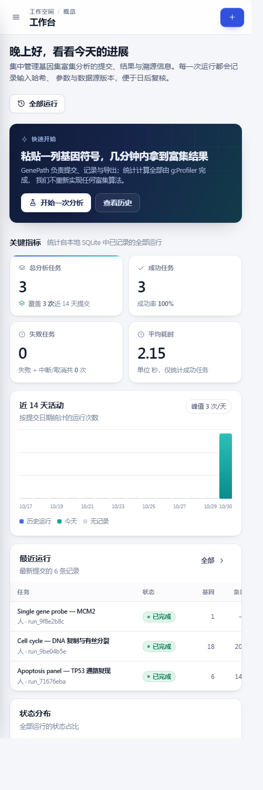

# GenePath Runner

面向科研人员的**基因富集分析运行记录与管理平台**。粘贴一组基因符号，选择物种与注释来源，GenePath 负责把这次分析**提交、排队、调用上游、持久化、追溯、导出**；富集统计全部由 [g:Profiler](https://biit.cs.ut.ee/gprofiler/) 官方 REST 接口（`POST /gprofiler/api/gost/profile/`）完成。

GenePath 不重新实现任何富集算法，也不生成生物学结论。它的价值在"可复现"：每一次提交都会留下输入哈希、参数快照、原始请求、上游原始响应、数据源版本与完整事件轨迹。

> **当前阶段：阶段二（真实分析 + 前后端联调）。**
> 提交的基因列表会进入本地队列，由 worker 真实调用 g:Profiler，结果与原始 JSON 一并落库，前端轮询状态并渲染真实富集条目。
> 演示数据的开关默认关闭（`-seed=false`）：新装环境从空工作区开始，看到的是专门设计的空状态，而不是编造的数字。


---

## 1. 技术栈

| 层 | 选型 | 说明 |
| --- | --- | --- |
| HTTP | Go + Gin | 显式路由，页面路由逐条注册，打错字会立刻 500 而不是静默回错页 |
| 持久化 | GORM + SQLite（纯 Go 驱动 `glebarez/sqlite`） | 零 CGO，单文件数据库，方便演示与备份 |
| 执行 | 进程内 worker 池 + 有界队列 | 提交立即返回 `202/201`，worker 异步执行，前端轮询状态 |
| 前端 | 原生 HTML / CSS / JavaScript + Fetch | 无框架、无构建步骤、无 CDN，静态资源被 `go:embed` 打进二进制 |
| 图表 | 手写 SVG / CSS 条形图 | 不引入图表库，配色与设计令牌统一 |
| 上游 | g:Profiler REST（`gost/profile`） | 官方接口，按官方文档字段构造请求，不猜参数 |
| 测试 | Go `testing` + `httptest` | 43 个测试函数，上游用 `httptest.Server` 伪造，测试不依赖网络 |

## 2. 快速开始

```bash
# 1. 构建
go build -o bin/genepath.exe ./cmd/server      # Windows
go build -o bin/genepath ./cmd/server          # macOS / Linux

# 2. 运行（默认 :8080，数据库 data/genepath.db，默认不写任何演示数据）
./bin/genepath

# 3. 打开
#    工作台   http://127.0.0.1:8080/
#    新建分析 http://127.0.0.1:8080/new
#    运行历史 http://127.0.0.1:8080/history
#    健康检查 http://127.0.0.1:8080/healthz
```

第一次打开工作台会看到空状态；去「新建分析」粘贴基因（或点示例基因集）提交，几秒后结果即可查看。

### 命令行参数与环境变量

| 参数 | 环境变量 | 默认值 | 说明 |
| --- | --- | --- | --- |
| `-addr` | `GENEPATH_ADDR` | `:8080` | 监听地址 |
| `-db` | `GENEPATH_DB` | `data/genepath.db` | SQLite 文件路径，目录会自动创建 |
| `-seed` | `GENEPATH_SEED_DEMO` | `false` | 空库首次启动时写入**标注过的**演示数据集（仅用于界面演示） |
| `-workers` | — | 由配置决定 | 并发 worker 数量 |
| `-timeout` | — | 由配置决定 | 单次上游调用的超时 |
| `-dev` | — | `false` | 开发模式：4xx/5xx 日志附带 request_id，CSP 更宽松 |
| `-version` | — | `0.1.0` | 显示在页脚与 `/healthz` 中 |
| `-provider-endpoint` | `GPROFILER_ENDPOINT` | `https://biit.cs.ut.ee/gprofiler/api/gost/profile/` | 上游接口地址（测试时指向 httptest） |

## 3. 目录结构

```text
.
├── cmd/server/main.go               进程入口：配置、迁移、worker 启动、路由、优雅退出
├── internal/
│   ├── config/config.go             环境变量 + 默认值
│   ├── database/
│   │   ├── database.go              打开 SQLite、PRAGMA、自动迁移
│   │   └── seed.go                  演示数据集（固定随机种子，canonical 标注）
│   ├── model/run.go                 Run / Term / RunEvent 三张表与状态常量
│   ├── dto/dto.go                   对外 JSON 结构：请求体、响应体、错误体
│   ├── catalog/catalog.go           物种与注释来源白名单（前端选项的唯一来源）
│   ├── gene/geneset.go              基因列表解析：分隔符、去重、大小写、上限、哈希
│   ├── repository/run_repository.go 查询封装：分页、筛选、聚合、事务写入
│   ├── provider/gprofiler/client.go 上游客户端：请求构造、超时、状态码、JSON 解析
│   ├── executor/executor.go         worker 池：消费队列、驱动状态机、重试与超时
│   ├── service/run_service.go       业务规则：校验、哈希、状态流转、结果转换、报告渲染
│   └── httpapi/
│       ├── router.go                路由表、CSP、请求 ID、访问日志、404 页
│       ├── handlers.go              绑定参数 → 调用 service → 统一错误响应
│       ├── errors.go                problem+json 风格错误与错误码
│       └── api.go                   依赖注入容器
├── web/
│   ├── embed.go                     go:embed 静态资源
│   └── static/
│       ├── index.html               工作台
│       ├── new.html                 新建分析
│       ├── results.html             分析结果
│       ├── history.html             运行历史
│       └── assets/
│           ├── css/tokens.css       设计令牌：色板、间距、圆角、阴影、字体
│           ├── css/app.css          布局骨架：侧边栏、顶栏、卡片、表格、表单
│           ├── css/pages.css        单页专属：图表行、时间线、KPI、分页
│           ├── js/ui.js             DOM 工具、图标、格式化、Toast、骨架屏
│           ├── js/api.js            REST 封装：超时、错误映射、类型收窄
│           ├── js/dashboard.js │ new.js │ results.js │ history.js
│           └── img/favicon.svg
└── docs/screens/                    验收截图（桌面端 + 窄屏）
```

分层依赖方向固定为 `handler → service → repository → database`；`service` 不 import Gin，因此可以直接用 Go 测试。上游访问被收在 `provider.Client` 接口后面，测试用假实现替换，因此测试既快又不需要网络。

## 4. REST API

公开命名空间是 `/api/v1`（`/v1` 作为旧链接别名保留）。错误体统一为 `{ code, message, details }`，响应头回写 `X-Request-Id`。

| 方法 | 路径 | 用途 |
| --- | --- | --- |
| GET | `/healthz` | 存活与数据库连通性 |
| GET | `/readyz` | 就绪检查（执行器未就绪时 503） |
| GET | `/api/v1/meta` | 物种、注释来源、阈值/校正选项、上游名称与地址 |
| GET | `/api/v1/dashboard` | 统计、14 天活动、状态分布、最近运行、来源分布、平均耗时、成功率 |
| GET | `/api/v1/runs` | 分页列表，支持 `status` / `organism` / `q` / `limit` / `offset` |
| POST | `/api/v1/runs` | 提交分析：解析 → 校验 → 去重 → 哈希 → 落库 → 入队 → 返回运行详情（`201`） |
| POST | `/api/v1/runs/validate` | 只校验不落库，供前端实时统计调用 |
| GET | `/api/v1/runs/:id` | 运行详情：参数、条目、事件轨迹、基因列表、上游元数据 |
| GET | `/api/v1/runs/:id/results` | 富集条目 + 溯源信息（数据源版本、HTTP 状态、耗时、体积） |
| GET | `/api/v1/runs/:id/raw` | 保存的原始请求体与原始响应体（JSON） |
| GET | `/api/v1/runs/:id/report.md` | 服务端渲染的 Markdown 报告 |
| DELETE | `/api/v1/demo` | 清空标注过的演示数据（真实运行不受影响） |

### 错误码

| HTTP | code | 场景 |
| --- | --- | --- |
| 400 | `bad_request` | 请求体不是合法 JSON |
| 404 | `not_found` | 运行不存在 / 页面不存在 |
| 409 | `queue_full` | 队列已满，稍后重试 |
| 422 | `validation_failed` | 字段级校验失败，`details` 里是 `字段 → 提示` |
| 503 | `executor_not_ready` | 执行器未接入（服务以无 worker 模式启动） |
| 502 | `provider_error` | 上游返回非 2xx 或响应无法解析（错误详情落库到运行记录） |
| 504 | `provider_timeout` | 上游超时 |

## 5. 数据模型与状态机

- **runs**：一次提交的不可变记录。含 `input_hash`（规范化基因集的 SHA-256，顺序与大小写无关）、`organism`、参数快照（JSON）、`source_version`、`status`、`outcome`、`gene_count`、`mapped_count`、`term_count`、耗时、上游 HTTP 状态与字节数、`is_demo`。
- **terms**：上游返回的富集条目。逐字段保存 g:Profiler 的原值：`p_value`、`term_id`（如 `GO:0072332`）、`native`、`name`、`source`、`intersection_size`、`query_size`、`term_size`、命中基因列表；GenePath 不做任何统计变换。
- **run_events**：生命周期事件（提交、入队、开始执行、调用上游、基因映射、完成、失败），带时间戳，驱动结果页的"审计轨迹"。

状态机：`queued → running → succeeded | failed`，另有 `canceled`。`succeeded` 再用 `outcome` 区分三种真实结局：

| outcome | 含义 |
| --- | --- |
| `enriched` | 请求成功且有条目通过显著性阈值 |
| `no_significant_terms` | 请求成功、基因已映射，但没有条目通过阈值 |
| `no_genes_mapped` | 请求成功，但输入的基因在该物种注释库里一个都没匹配上 |

失败路径单独落库：`provider_error`（非 2xx / 解析失败）、`provider_timeout`（超时）、`internal_error`。失败时原始响应体若存在也会保存，便于复盘。

## 6. g:Profiler 接入

请求字段按官方文档构造，没有猜测：

```json
{
  "organism": "hsapiens",
  "query": ["TP53", "BAX", "CDKN1A"],
  "sources": ["GO:BP", "KEGG"],
  "user_threshold": 0.05,
  "significance_threshold_method": "g_SCS",
  "background": "annotated",
  "domain_scope": "annotated",
  "no_evidences": false,
  "all_results": false
}
```

实现要点：

1. **超时**：整个调用受 `context` 与 `http.Client.Timeout` 双重约束，超时映射为 504 并把原因写进运行记录。
2. **状态码**：非 2xx 一律视为失败，保存状态码与响应体摘要，不把错误包装成"零结果"。
3. **数据源版本**：从响应的 `meta.version` 取（例如 `e114_eg62_p19_9dc92ac8`），连同 `meta.timestamp` 一起落库并展示在结果页与报告里。
4. **原始留存**：请求体与响应体原样保存（`/runs/:id/raw`），响应体积在演示中约 100 KB（6 个基因、148 条注释），因此不做截断。
5. **统一结构**：上游 JSON 在 `service` 层转换成内部 `Term` 结构，前端只依赖内部结构，上游字段改名不会扩散到页面。
6. **映射统计**：`genes_metadata` 里的 `failed`、`duplicates`、`ambiguous`、`query.mapping` 会被用来展示"输入 N 个基因，映射 M 个，未映射 …"，未映射的基因显式展示，不悄悄丢弃。
7. **频率限制**：g:Profiler 公共接口有速率限制（响应头里带 `X-RateLimit-*`），因此执行器使用有界队列与有限并发，而不是无限制并发提交。

## 7. 界面

四页共用同一套设计语言：深海军蓝侧边栏、靛蓝主操作色、青绿辅助色、浅灰白画布与低对比边框。所有颜色、圆角、阴影都来自 `tokens.css`，换主题只需改一处。

| 页面 | 关键内容 |
| --- | --- |
| 工作台 | 4 个 KPI（全部来自 `/api/v1/dashboard`）、14 天活动柱状图、状态分布环图、最近 6 条运行、来源分布、快捷入口 |
| 新建分析 | 基因粘贴区、实时统计（有效/重复/无效）、物种与注释来源、阈值与校正、示例基因集、输入哈希与重复提交提示、提交中禁用与错误内联提示 |
| 分析结果 | 真实结果概览、`-log10(p)` 条形图、可排序可筛选的条目表、命中基因、运行参数、溯源信息、审计轨迹、原始请求/响应、报告下载 |
| 运行历史 | 状态分段筛选、关键词搜索、物种筛选、状态标签、耗时、输入哈希、数据源版本、详情入口、分页 |

三种状态都有专门设计：加载用骨架屏，空数据说明"为什么空"，错误给出可重试的提示。例如某个基因在注释库里没有显著条目时，结果页显示的是：


<table>
<tr>
<td></td>
<td></td>
</tr>
<tr>
<td></td>
<td></td>
</tr>
</table>

## 8. 测试

```bash
go test ./... -count=1                       # 43 个测试函数
go test ./... -count=1 -cover -p 1           # 带覆盖率
go vet ./...                                 # 静态检查
```

最近一次本地结果（Windows，Go 1.26.4）：

| 包 | 结果 | 覆盖率 |
| --- | --- | --- |
| `internal/gene` | ok | 97.9% |
| `internal/executor` | ok | 91.4% |
| `internal/httpapi` | ok | 74.5% |
| `internal/provider/gprofiler` | ok | 74.1% |
| `internal/service` | ok | 62.8% |

测试覆盖的关键行为：

- 基因解析：换行/逗号/分号/空格混排、注释行、大小写去重、非法字符、单基因上限、哈希顺序无关。
- 上游客户端：请求体字段正确、超时、非 2xx、坏 JSON、`meta.version` 提取、映射统计。
- 执行器：队列满、状态推进、重试、超时、panic 兜底、优雅退出。
- 业务层：三种 outcome（enriched / no_significant_terms / no_genes_mapped）、失败落库、重复哈希提示、报告渲染。
- HTTP 层：`/api/v1` 路由契约、字段校验 422、404、CSP 头、静态资源、页面路由。

## 9. 阶段二验收记录

| 验收项 | 证据 |
| --- | --- |
| 真实上游调用 | 用真实基因列表提交 3 次，上游返回 `e114_eg62_p19_9dc92ac8`，6 基因/148 条、18 基因/206 条、1 基因/0 条 |
| 请求有记录 | 每次运行保存 `request` / `response` 原始 JSON，体积 233 B / 98 KB 量级 |
| 结果未篡改 | 条目表格逐条显示上游 `p_value`、`term_id`、`native`、`intersection`，后端不做统计变换 |
| 三种结局可分 | `enriched` / `no_significant_terms` / `no_genes_mapped` 均有专门文案与截图 |
| 前端联调 | 提交后轮询 `/api/v1/runs/:id`，从"排队中"推进到"已完成"，图表、表格、溯源信息均来自真实响应 |
| 工作台真实 | KPI、活动图、来源分布全部来自 `/api/v1/dashboard`；空库显示空状态，不填假数据 |
| 报告下载 | `/api/v1/runs/:id/report.md` 返回 `text/markdown`，含参数、溯源、条目表 |
| 错误响应 | 空基因 422、非法字符 422、超 2000 个 422、未知物种 422、无来源 422、坏 JSON 400、不存在 404 |
| 测试 | `go test ./...` 全绿，覆盖率见第 8 节 |
| 静态检查 | `go vet ./...` 无输出 |

## 10. 尚未实现

1. **取消与重跑**：状态机里有 `canceled`，但还没有对外接口。
2. **Docker**：还没有 `Dockerfile`，下一步补一个多阶段构建。
3. **鉴权与多用户**：当前是单用户本地工作区，没有登录与租户隔离。
4. **数据库迁移版本表**：现在依赖 GORM `AutoMigrate`，字段变更没有版本化迁移。
5. **静态资源指纹**：文件路径固定，靠 `Cache-Control` 控制，未做内容哈希（浏览器缓存旧 JS 是这个阶段的已知坑）。
6. **报告导出格式**：只有 Markdown，没有 CSV / PDF。
7. **LLM 辅助解读**：不做。参见下一节。
8. **LICENSE**：尚未选定，发布前需要确定（MIT / Apache-2.0 均可）。

## 11. 诚实性约定

- 不重算 p 值，不修改上游统计结果，不在界面上给生物学结论。
- 演示数据默认关闭；开启时永远带 `演示` 标记，`is_demo` 落库，报告里也会注明。
- 未映射的基因、重复的基因、无效的符号都要显式展示，不能悄悄丢弃。
- 上游失败就显示失败：不会把"请求失败"渲染成"没有显著结果"。
- 不把大模型生成的生物学解释写进结果页——那正是这个项目要避免的"看起来可信"。

## 12. 已知限制

- g:Profiler 公共接口有速率限制，批量提交时队列会排队而不是并发轰炸。
- 单机 SQLite 写入串行，适合个人/小团队使用；多实例部署需要换成 Postgres 并引入任务租约。
- 页面为桌面优先设计，≤900px 时侧边栏收为抽屉、表格在卡片内横向滚动。
